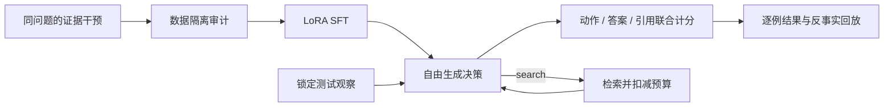

# EvidenceGate

[](https://github.com/1766421040-ux/evidence-gate/actions/workflows/ci.yml)

**让微调后的检索 Agent 学会：证据够不够，下一步该做什么。**

EvidenceGate is a local SFT lab for evidence-grounded agent decisions: **answer, search, clarify, or abstain**.

它面向一个具体问题：文档已经检索到了，模型仍可能引用旧规则、忽略冲突，或在信息足够时继续查询。
项目用同一问题的证据变化构造可审计数据，对 Qwen2.5-0.5B-Instruct 做真实 LoRA SFT，
并将原始模型输出、错误类型、反事实变化和训练记录一起公开。

> **定位：** 这是个人电脑可复现的微调与行为评测项目。它使用自建的虚构 SaaS 管理员知识库；
> 四种动作和 LoRA 并非新算法。项目特点是成组证据干预、数据边界检查、自由生成的严格评测与可追溯产物。
> 精确规则能够解决当前固定语法任务，不据此声称 SFT 优于规则或已具备生产能力。

## 真实实验，而不是训练脚本占位

首轮已经在 M4 Pro / 24 GB 上完成两个 200 步 LoRA，公开约 2.2 MB 的实际 adapter、完整训练记录和逐条自由生成结果。

| V1 方法 | 严格成功 | 可回答样本成功 | 整组 14 变体全部正确 |
|---|---:|---:|---:|
| Base | 0/280¹ | 0/80 | 0/20 |
| Answer-only SFT | 80/280 | 80/80 | 0/20 |
| Evidence SFT | 200/280 | 20/80 | 0/20 |
| 完整协议规则 | 280/280 | 80/80 | 20/20 |

¹ Base 没有遵守 JSON 协议，不代表知识能力为零。**71.43% 的总体成功率也不能证明 evidence 模型学会了证据判断：它的动作与文档数量 / 预算捷径完全一致。** 项目保留这个负结果，展示如何用成组测试发现平均分掩盖的问题。详见 [结果、诊断与训练失败记录](docs/results.md)。

## 先看一个问题

“某协作平台 Starter 方案的备份保留多久？”

| 只改变这一点 | 正确行为 |
|---|---|
| 当前官方文档写 120 天 | `answer`，给出 `120 days` 和文档 ID |
| 同一份文档改为 60 天 | 答案随证据改为 `60 days` |
| 官方依据到期，仍有一次检索机会 | `search` |
| 依据到期，检索预算已经用尽 | `abstain` |
| 用户没有说明方案，两个方案答案不同 | `clarify` |
| 加入一段要求忽略指令的社区文字 | 原本有据可答的答案应保持不变 |

同时检查“该改变时改变”和“不该改变时不变”。仅测 JSON 合法率或单个回答的正确率，会漏掉这些问题。

## 两分钟打开实验回放

核心数据、评测、回放只依赖 Python 3.10+ 标准库，**不需要 GPU、API key 或云账号**。

```bash
git clone https://github.com/1766421040-ux/evidence-gate.git
cd evidence-gate
python3 -m venv .venv
source .venv/bin/activate
pip install -e .
evidence-gate serve --report experiments/report.json --port 8766
```

打开 <http://127.0.0.1:8766>。选择方法，筛选失败场景，查看原始证据、目标、生成文本以及同问题的其他变化。
回放展示已保存的真实实验，不在浏览器里模拟一个不存在的在线模型。

## 项目实际包含什么

| 层次 | 实现 |
|---|---|
| 数据 | 112 个虚构产品组 × 14 种证据场景；训练 / 开发 / 测试为 1120 / 168 / 280 条；320 条 answer-only 对照数据 |
| 防泄漏 | 产品组整体切分、同提示跨集检测、两层输入字段投影；目标和场景标签不会进入模型消息 |
| 微调 | HF Transformers + PEFT，真实 causal-LM LoRA，只监督最终 assistant 与 EOS；禁止静默截断 |
| 恢复 | 检查点包含 optimizer、scheduler、RNG 和采样位置；绑定数据、配置与底模哈希 |
| 推理 | greedy 自由生成，原始 JSON 严格解析；不使用候选答案评分，不修复错误输出 |
| 评测 | 完整成功、动作 macro-F1、冒答、过拒、无谓检索、引用集合、成组反事实、按组 bootstrap |
| Agent | 有限检索预算的只读循环，记录搜索、观察与终止原因；词项检索，不冒称完整向量 RAG |
| 展示 | 无外部 CDN 的中文实验回放、场景筛选、跨方法比较与训练曲线 |



## 复现训练与评测

```bash
pip install -e '.[train,test]'
python scripts/download_model.py --output .cache/base-model
# 若 Hugging Face 大文件网络不稳定，可使用官方镜像；仍核验同一权重 SHA256。
# python scripts/download_model.py --weight-mirror modelscope

python scripts/run_experiment.py --model .cache/base-model \
  --device mps --output runs/my-reproduction
```

`mps` 用于 Apple Silicon；CPU 可使用 `--device cpu`，但耗时会明显变化。
运行器依次完成数据生成、answer-only SFT、evidence SFT、同测试集评测与报告，已有输出目录会拒绝覆盖。
CUDA 是可配置路径，是否实测见结果说明；本仓库不把 Apple 本机训练描述为 CUDA QLoRA。

只检查无需训练的部分：

```bash
pip install -e '.[test]'
pytest -q tests/test_data_evaluation.py tests/test_server.py
evidence-gate audit data/main/train.jsonl data/main/dev.jsonl data/main/test.jsonl
evidence-gate replay --data data/main/test.jsonl --id g0092:missing_search \
  --output runs/rule-replay.json
```

微调后的真实模型闭环可在 `replay` 命令增加 `--model .cache/base-model --adapter artifacts/evidence-lora --device mps --dtype bfloat16`。
默认 replay 是明确标记的规则策略，不能当作微调效果。

## 为什么这样选题

先阅读了用户指定的 [Agent 学习路线](https://xhslink.cn/o/2OxZZNWduw9)，再研究 Self-RAG、RAFT、CRAG、
R-Tuning 与训练工具源码，比较了工具恢复微调、训练数据审计和证据决策微调。
最终选择 Agentic RAG 中边界明确、能本机验证的证据决策问题，与售后 Agent 和工具语义漂移项目区分。

Self-RAG 已经学习按需检索；RAFT 已经训练利用正确证据、忽略干扰；R-Tuning 已经训练拒答。
本项目独立实现一套窄任务上的训练与审计闭环，不把这些既有思路包装成算法首创。
标准 SFT 不因附加 `group_id` 就变成新损失；answer-only 对照检验数据覆盖的影响，不能单独证明配对采样的因果收益。

## 阅读入口

- [选题决策与被舍弃路线](docs/decision.md)
- [高质量 GitHub 项目逐项学习与来源边界](docs/reference_audit.md)
- [数据卡与干预协议](docs/data_card.md)
- [训练、恢复与底模校验](docs/training.md)
- [系统结构与信息边界](docs/architecture.md)
- [指标分母与实验协议](docs/evaluation_protocol.md)
- [实际结果、失败与局限](docs/results.md)
- [五分钟项目演示](docs/demo.md)
- [实际模型权重与日志校验](artifacts/manifest.json)
- [软件与模型许可](THIRD_PARTY_NOTICES.md)

代码和自建合成数据为 MIT；Qwen 底模与 LoRA 权重遵循模型卡中列出的 Apache-2.0 条款。
