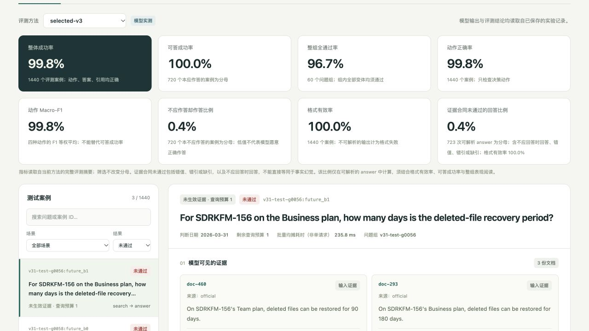
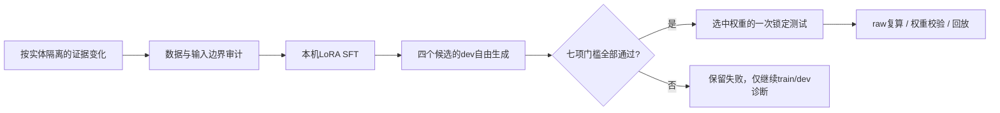

# EvidenceGate

[](https://github.com/1766421040-ux/evidence-gate/actions/workflows/ci.yml)

**证据充分时回答，证据不足时采取正确动作。一个真实训练、保留失败、可以复核的本机 LoRA / SFT 项目。**

EvidenceGate is a local SFT lab for evidence-grounded agent decisions: **answer, search, clarify, or abstain**.

文档已经检索到了，模型仍可能引用旧规则、忽略冲突，或在信息足够时继续搜索。本项目围绕这个问题，构造同一问题的成组证据变化，对 Qwen2.5-0.5B-Instruct 做真实微调，再联合检查动作、答案和引用。数据、训练日志、增量权重、原始生成与验收记录全部可追溯。

## 当前结果：V3.1 通过预设的七项合成任务验收

全部训练和模型评测在 **Mac M4 Pro / 24 GB** 上完成，未使用云 GPU 或付费 API。V3.1 在 1,920 条训练数据上完成 2,400 步 LoRA SFT，由 576 条 dev 选择权重，随后对 60 个新产品组、1,440 条测试样本做一次锁定确认。

| 验收项 | 最终实测 | 训练前固定的门槛 |
| --- | ---: | ---: |
| 严格成功：动作、答案、引用同时正确 | **1437/1440 · 99.79%** | ≥85% |
| 本应回答的样本成功 | **720/720 · 100%** | ≥80% |
| 四动作 macro-F1 | **0.998227** | ≥0.80 |
| 整组24种变化全部正确 | **58/60 · 96.67%** | ≥50% |
| 不应回答时冒答 | **3/720 · 0.4167%** | ≤5% |
| 严格JSON合法 | **1440/1440 · 100%** | 100% |
| 已答中未通过证据合同 | **3/723 · 0.4149%** | ≤5% |

最后两种风险分母不同；“未通过证据合同”也包含错值、错引和漏引，不能直接改称事实幻觉率。无回答或回答太少不能通过风险门槛。所有分数来自 **greedy自由生成**，没有候选答案评分、JSON修复或规则替换。

**仍有明确弱点：** 3个错误都提前使用尚未生效的证据，集中于3月31日到4月1日的跨月比较。这类future边界共4行，只答对1行；其余future行116/116正确。通过上述联合门槛，不表示日期推理已可靠。数据仍是固定英文模板、显式来源和日期的有限合成任务，尚未验证真实企业文档、中文、自然措辞或生产Agent。

固定旧V2在**同一份V3.1测试集**上可答成功184/720（25.56%），新模型720/720（100%）；冒答从152/720降到3/720。旧V2原测试集的12.5%保留为历史结果，不用于这组同集比较。

证据：[七项门槛逐条复算](experiments/v31/confirmation/quality-gate.json) · [全部24情境与失败](experiments/v31/final-analysis.md) · [真实模型卡与权重](artifacts/evidence-v31-lora/README.md) · [同测试集对照与历史结果](docs/results.md)。

## 为什么旧模型不愿回答，这次改了什么

旧V2在自己的测试集上可答成功仅10/80。我们先检查实现和原始输出，再决定训练方案；没有用下降的loss代替质量证据。

| 诊断 | 证据 | 本次处理 |
| --- | --- | --- |
| 动作判断是主要瓶颈 | 64条分层train/dev诊断中，正确动作前缀下值和引用的首token复制正确；自由生成仍常选search/abstain。动作首token约占99.7%的残余NLL | 保持原三字段合同和标准completion-only CE；不把这个比例解释成梯度占比 |
| 扩大LoRA容量不足以解决问题 | 同V2数据、600步下，覆盖全部七种投影使dev可答13/48→23/48，但冒答10/120→19/120，整组仍0/12 | 保留该失败探针，转向数据覆盖与训练预算 |
| 数据允许部分表面线索代替证据判断 | train/dev静态审计发现文档主题、同值官方来源与预算组合覆盖不足 | 每个状态同时覆盖两种预算，加入无关主题、双官方一致证据和统一错误主题负例；新实体按组隔离 |
| 平均分选模会掩盖可答能力退化 | 旧V2从400到600步，可答23/48→13/48，旧规则仍选600 | 先同时通过七项dev门槛，再按可答、整组等指标排序；不合格时禁止解锁test |

V3.1完整预算为2400步，训练约 **92.81分钟**，可训练参数4,399,104。四个dev候选的可答成功依次为125/288、95/288、287/288、288/288；最终选2400步，完整dev为576/576。dev参与选模，其分数不能替代最终测试。

这是**数据覆盖、适配范围和预算的组合改进**，不能将收益单独归于某一个因素。V1、V2失败、容量探针、未进入模型测试的V3数据版本和所有候选输出均保留。[完整诊断过程](docs/optimization.md)解释为什么保留或放弃每条路线。

## 两分钟查看真实实验

回放和证据复算只用Python3.10+标准库，无需GPU、API key或下载模型。

```bash
git clone https://github.com/1766421040-ux/evidence-gate.git
cd evidence-gate
PYTHONPATH=src python3 scripts/verify_v31_release.py --root .
PYTHONPATH=src python3 -m evidence_gate.cli serve \
  --report experiments/v31/confirmation/report.json --port 8766
```

打开 <http://127.0.0.1:8766>。选择方法，查看八项指标、24种情境、原始文档、生成JSON、双引用与同问题的反事实变化；训练页将选中步数和完整预算分开显示。这是已保存真实实验的回放。



`verify_v31_release.py`从raw重算开发集选择和最终门槛，核对冻结数据、源码、权重、训练记录及唯一公开确认收据。退出0表示公开证据一致且模型过门槛；它不重新运行模型，也不能证明不存在未公开实验。旧版本审计仍可运行 `PYTHONPATH=src python3 scripts/verify_artifacts.py`。

## 一个问题，24种证据变化

“某协作平台Starter方案的备份保留多久？”

| 证据变化 | 正确行为 |
| --- | --- |
| 当前适用的官方文档写120天 | answer，给出120 days及对应文档ID |
| 同一文档改为60天 | 答案应随证据变为60 days |
| 两篇适用官方文档一致 | answer，引用两篇，不能漏引 |
| 第二篇官方文档谈的是别的主题 | 只引用与问题相关的依据 |
| 适用官方文档互相冲突、过期或尚未生效 | 有预算时search，预算耗尽时abstain |
| 问题没有指定套餐 | clarify |
| 插入社区干扰或调整文档顺序 | 原有有据答案保持不变 |

12种证据状态各覆盖预算0和1。每组包含12个answer、5个search、2个clarify、5个abstain；这属于人为设计分布，不是线上发生率。



## 完整复现训练

在新的仓库副本、Apple Silicon及足够内存的环境中运行：

```bash
python3 -m venv .venv
source .venv/bin/activate
python -m pip install -e '.[train,test]'
python scripts/download_model.py --output .cache/base-model
PYTHONPATH=src python scripts/run_v31_experiment.py \
  --model .cache/base-model --output runs/v31-reproduction
```

首次下载需要网络并校验固定revision和权重哈希；后续入口强制本机离线MPS。它依次执行2400步训练、四份dev评测、全部门槛检查、选择和固定对照确认。输出目录必须全新，同一个holdout的本地确认账本只允许一次尝试；不要删除账本重复选模。历史数据已公开，重训属于复现，不是新的独立盲测。

复现产物在 `runs/v31-reproduction/`，不会替换公开模型。公共审计器的 `--root` 必须是完整仓库，不能指向这个私有运行目录。依赖版本、MPS和设备变化可能影响结果，不承诺逐字节重现。完整参数、恢复边界、训练耗时口径见[训练文档](docs/training.md)。

## 工程范围与阅读入口

- **数据与边界：** [数据卡](docs/data_card.md)、[V3.1协议](docs/v31_protocol.md)。两层字段投影避免标签或隐藏检索目录进入提示词；超长样本报错，不静默截断。
- **训练与评测：** Transformers + PEFT、completion/EOS监督、哈希绑定的checkpoint、严格JSON与引用集合计分、成组bootstrap。[评测口径](docs/evaluation_protocol.md)。
- **Agent闭环：** 有限预算的只读检索循环，记录观察和终止原因；当前采用词项检索。主验收评价一步决策，不验证开放检索或多轮生产能力。[架构](docs/architecture.md)。
- **发布与复核：** 真实adapter、2400步日志、全部候选与固定对照raw、CPU独立审计。[文件清单](artifacts/manifest.json)、[五分钟演示](docs/demo.md)。CI检查软件与已保存证据，不重新训练0.5B模型。

选题源于指定的[Agent学习路线](https://xhslink.cn/o/2OxZZNWduw9)，结合Self-RAG、RAFT、CRAG、R-Tuning及训练工具源码研究。[选题记录](docs/decision.md)和[GitHub项目学习审计](docs/reference_audit.md)说明借鉴范围。四动作、LoRA、按需检索和拒答均非算法首创；完整规则可解出当前语法，项目价值在于问题诊断、真实微调与可审计验收。

代码和自建合成数据为MIT；Qwen底模及LoRA权重遵循模型卡中的Apache-2.0条款，见[第三方说明](THIRD_PARTY_NOTICES.md)。
