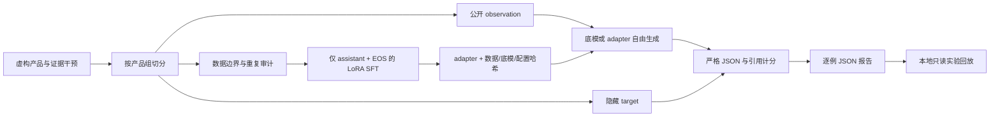

# 系统结构与信息边界

EvidenceGate 将 **数据生成、模型训练、自由生成、独立计分、只读回放** 分开。规则策略是对照，不会修正模型答案。

## 一个请求的路径

1. `messages_for` 只投影 `question/as_of/budget/documents`，文档也只保留五个公开字段。
2. 模型接收固定行为合同和公开观察，greedy 生成 JSON。没有候选答案评分、正则补全或隐藏标签。
3. `parse_prediction` 拒绝 Markdown 包装、额外字段、重复键、伪造类型和不一致的动作参数。
4. `score` 独立读取 target，检查动作、值和完整引用集合；三者同时正确才是 success。
5. `summarize` 按来源组 bootstrap，同时保留场景切片、混淆矩阵和反事实配对。无回答时的引用率为 null。

`agent.run_episode` 另外提供实际检索闭环：`search → lexical retrieval → budget - 1 → model decision`。
检索是确定性词项交集排序，最多返回四份文档；没有声称向量检索、BM25、Rerank 或 MCP 已实现。
环境 corpus 与 policy 分离；policy 只看当前公开观察。任何零预算 search 都终止为 `budget_violation`；
非法输出终止为 `invalid_output`，不会被悄悄改成正确答案。最多四步，所有调用留 trace。

## 数据和模型的身份

- 原始底模固定上游 revision；官方镜像下载的权重也必须匹配同一 SHA256。
- 训练 manifest 绑定 JSONL 字节、规范化配置和模型/分词器文件指纹。
- adapter 以 safetensors 保存；恢复文件由 JSON 元数据和 safetensors optimizer/RNG 组成，不读取 pickle。
- 同一运行恢复要求模型、配置和数据指纹完全一致；修改训练配置需新建运行。
- 预测文件保存实际底模指纹和 adapter SHA；报告附带的训练摘要必须能匹配已评测 adapter。
- 训练曲线是优化过程，不能代替留出集行为结果。

## 三类组件不能混为一谈

| 组件 | 作用 | 不能证明什么 |
|---|---|---|
| `contract_rule` | 读取公开字段和固定英文语法的强规则对照 | 真实自然语言通用理解 |
| LoRA controller | 对完整输入进行下一词生成 | 生产安全、复杂业务规划或规则必需性 |
| 回放 UI | 展示已保存的原始输入、预测、计分和曲线 | 在线交互式推理或实时训练监控 |

当前知识值是单个天数，来源可信度是显式元数据；这些条件让实验可审计，也限制了真实应用外推。
合成恢复 corpus 提供当前官方文档，闭环难度不代表生产检索系统。所有回答均属虚构服务，无真实客户数据。

## 本地服务

服务以启动时的报告快照提供固定 GET 路由，绑定 `127.0.0.1`，没有写接口、外部 CDN、账号或云调用。
浏览器的筛选仅改变展示，不改变总体指标的分母。安装包同时携带静态资源；源码和 wheel 都能启动。
该服务是个人实验浏览器，不是多用户互联网部署方案。
